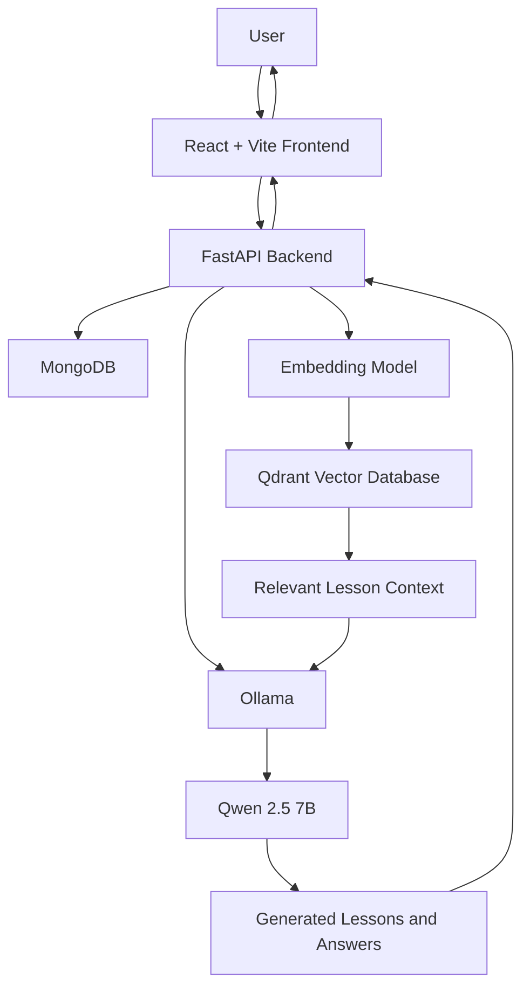

# 🇮🇳 FinLearn India — AI-Powered Financial Education

**One platform. AI-powered teaching. Smarter financial learning.**

FinLearn India is an AI-powered financial education platform designed to make learning about finance and the stock market more accessible, interactive, and structured. By combining Large Language Models (LLMs), Retrieval-Augmented Generation (RAG), and multilingual learning support, the platform aims to simplify complex financial concepts and empower learners to make more informed financial decisions.

The project also explores how AI can support educators by generating structured educational content, managing lesson drafts, and creating interactive assessments through a unified platform.

## 📌 Table of Contents

- [Overview](#-overview)
- [Key Features](#-key-features)
- [Technology Stack](#️-technology-stack)
- [System Architecture](#️-system-architecture)
- [How It Works](#-how-it-works)
- [Project Structure](#-project-structure)
- [Getting Started](#-getting-started)
- [Environment Configuration](#-environment-configuration)
- [Future Roadmap](#-future-roadmap)
- [Learning Outcomes](#-learning-outcomes)
- [Disclaimer](#️-disclaimer)
- [Author](#-author)

## 🚀 Overview

FinLearn India brings together AI-assisted teaching and financial education in one platform. It explores practical applications of generative AI to create educational materials, answer questions grounded in lesson content, and help learners understand financial concepts in a more accessible way.

The project was developed as a practical exploration of full-stack AI application development, connecting concepts such as LLMs, embeddings, vector databases, semantic search, and RAG into a working application.

### 🎯 Project Objectives

- Simplify financial and stock market education using AI.
- Support structured lesson and assessment generation.
- Enable contextual question answering using lesson-specific information.
- Improve accessibility through Hindi summaries.
- Explore practical applications of open-source LLMs in education.

## ✨ Key Features

### 📚 1. AI-Powered Teaching

Generate structured educational content using AI, including:

- Lessons and educational explanations.
- Key bullet points and notes.
- Quizzes and assessment questions.
- Learning materials organized for easier understanding.

The platform uses an LLM-powered backend to generate educational content in a structured format.

### 📝 2. Draft Management

Manage AI-generated educational content before making it available to learners.

- Create lesson drafts.
- Review generated content.
- Edit lesson explanations, bullet points, and notes.
- Manage educational material through dedicated workflows.

This approach keeps educators involved in reviewing and refining AI-generated content.

### 🧠 3. Ask AI — Retrieval-Augmented Generation (RAG)

Ask questions related to lesson content and receive contextual answers using Retrieval-Augmented Generation.

The RAG pipeline combines information retrieval with LLM-based answer generation, helping the system use relevant lesson material when responding to questions.

Core concepts involved:

- **Embeddings:** Convert text into numerical vector representations.
- **Vector database:** Store and retrieve vector representations of lesson content.
- **Semantic search:** Find relevant content based on meaning rather than exact keyword matches alone.
- **Context retrieval:** Provide relevant passages to the language model.
- **Answer generation:** Generate a response using the retrieved context.

Qdrant is used for vector storage and retrieval, while `nomic-embed-text` is used as the embedding model.

### 🎯 4. Interactive Quizzes

Support learning through AI-generated questions and explanations.

- Generate quiz questions based on educational content.
- Help learners evaluate their understanding.
- Provide explanations to reinforce important concepts.

### 🌐 5. Hindi Summaries

Make financial concepts more accessible through Hindi summaries.

The goal is to reduce language barriers in financial education, with the possibility of expanding to additional Indian regional languages in future iterations.

### 📈 6. Portfolio Analysis — Planned

Portfolio Analysis is a planned major feature of FinLearn India.

The proposed direction includes:

- Portfolio visualization.
- Investment performance analysis.
- Asset allocation insights.
- Portfolio-level metrics and summaries.
- AI-assisted explanations of investment-related concepts.

This feature is part of the future roadmap and is not represented as a completed feature.

## 🛠️ Technology Stack

| Technology | Purpose |
|---|---|
| React | Frontend user interface |
| Vite | Frontend development server and build tooling |
| Python | Backend application logic |
| FastAPI | Backend API development |
| MongoDB | Persistent application data storage |
| Ollama | Local LLM inference |
| Qwen 2.5 7B | Language model for AI-generated content and responses |
| `nomic-embed-text` | Text embedding generation |
| Qdrant | Vector database for semantic retrieval |
| HTML, CSS, JavaScript | Frontend structure, styling, and interaction |
| Git and GitHub | Version control and project hosting |

## 🏗️ System Architecture

FinLearn India follows a frontend–backend architecture with separate components for application logic, persistent storage, language-model inference, and vector retrieval.



### Architecture Components

**Frontend — React and Vite**

Provides the user interface for navigating the platform, accessing learning features, and interacting with the backend.

**Backend — FastAPI**

Handles API requests, application logic, educational-content workflows, and communication with the supporting services.

**Database — MongoDB**

Stores persistent application data, according to the application's implemented data models and workflows.

**LLM Inference — Ollama and Qwen 2.5 7B**

Runs the language model locally through Ollama to support AI-powered educational content generation and responses.

**Semantic Retrieval — Qdrant and `nomic-embed-text`**

Converts text into embeddings and supports vector-based retrieval of relevant lesson information for RAG workflows.

## 🔄 How It Works

### AI-Powered Content Generation

1. A user requests educational content through the frontend.
2. The frontend sends the request to the FastAPI backend.
3. The backend prepares the request for the language model.
4. Ollama runs Qwen 2.5 7B to generate the requested content.
5. The backend processes the output and returns it to the frontend.
6. The generated content can be reviewed and managed through the lesson workflow.

### Retrieval-Augmented Generation (RAG)

1. **Content preparation:** Extract or prepare lesson text for retrieval.
2. **Chunking:** Divide the text into smaller, meaningful passages.
3. **Embedding generation:** Use `nomic-embed-text` to transform passages into vectors.
4. **Vector storage:** Store the vectors and associated content in Qdrant.
5. **Question embedding:** Convert a user's question into a vector representation.
6. **Semantic retrieval:** Retrieve relevant lesson passages from Qdrant.
7. **Contextual generation:** Supply the retrieved passages to the LLM.
8. **Response delivery:** Return the generated answer to the frontend.

This workflow helps connect a general-purpose language model with relevant educational material.

## 📂 Project Structure

The project is organized into separate frontend and backend directories.

```text
FinLearnIndia/
│
├── backend/
│   ├── app/
│   │   ├── routes/
│   │   ├── services/
│   │   └── ...
│   ├── requirements.txt
│   └── ...
│
├── frontend/
│   ├── public/
│   ├── src/
│   │   ├── assets/
│   │   ├── components/
│   │   └── pages/
│   ├── package.json
│   └── vite.config.js
│
├── .gitignore
└── README.md
```

*Note: The directory tree is illustrative. Adjust the internal backend paths to match the actual folders in your repository.*

## 💻 Getting Started

Follow these instructions to set up the project locally.

### Prerequisites

Install or configure the following:

- Python compatible with your backend dependencies.
- Node.js and npm.
- MongoDB.
- Ollama.
- Git.

You will also need the required Ollama models and the project's Python and JavaScript dependencies.

### 1. Clone the Repository

```bash
git clone https://github.com/Vhet0511/FinLearnIndia.git
cd FinLearnIndia
```

### 2. Set Up the Backend

Open a terminal in the backend directory:

```bash
cd backend
python -m venv venv
```

Activate the virtual environment on Windows:

```powershell
.\venv\Scripts\Activate.ps1
```

If you use Command Prompt instead:

```cmd
venv\Scripts\activate
```

Install the Python dependencies:

```bash
python -m pip install -r requirements.txt
```

Configure the required environment variables for MongoDB, Ollama, and Qdrant according to your backend configuration.

Start the FastAPI server using the application's actual entry point. For example, if the application instance is defined as `app` in `app/main.py`:

```bash
uvicorn app.main:app --reload
```

The API documentation is typically available at:

`http://127.0.0.1:8000/docs`

### 3. Set Up Ollama

Install Ollama from the official website:

https://ollama.com/

Pull the required language and embedding models:

```bash
ollama pull qwen2.5:7b
ollama pull nomic-embed-text
```

Ensure the model names match those configured in the backend.

Ollama should be running and accessible to the backend before testing AI-powered features.

### 4. Configure MongoDB and Qdrant

Ensure MongoDB is running and the backend has a valid database connection string.

Qdrant must also be available using the connection configuration expected by the application. If your implementation uses a local Qdrant storage directory, configure it accordingly.

**Important:** The precise MongoDB database name, collection names, Qdrant collection configuration, and environment variable names depend on your implementation.

### 5. Set Up the Frontend

Open another terminal at the project root:

```bash
cd frontend
npm install
npm run dev
```

Open the local URL printed by Vite in your terminal, commonly:

`http://localhost:5173`

The frontend must be configured to communicate with the backend API at the correct address.

## ⚙️ Environment Configuration

Before running the application, configure the backend settings required by your implementation.

Typical configuration categories include:

| Configuration | Purpose |
|---|---|
| MongoDB connection URI | Connect to the application database |
| Ollama base URL | Connect to the local LLM service |
| LLM model name | Select the configured language model |
| Embedding model name | Select the text embedding model |
| Qdrant URL or storage path | Configure vector database access |
| Qdrant collection settings | Configure vector retrieval |

Use the environment variable names expected by your code; the table above describes configuration requirements rather than exact variable names.

Never commit real credentials, API keys, or private connection strings to GitHub. Use a local `.env` file if supported by your application, and provide a sanitized `.env.example` for contributors.

## 🗺️ Future Roadmap

FinLearn India is an evolving project. Potential improvements include:

- [ ] Portfolio Analysis and investment portfolio visualization.
- [ ] Expanded support for Indian regional languages.
- [ ] More personalized learning paths.
- [ ] Improved lesson retrieval and answer evaluation.
- [ ] Additional financial literacy modules.
- [ ] Enhanced educational-content review workflows.
- [ ] More comprehensive testing and deployment documentation.

## 📚 Learning Outcomes

Developing FinLearn India has provided an opportunity to connect AI concepts with practical software engineering.

Key areas explored include:

- **Large Language Models:** Integrating local language models into applications.
- **Prompt Engineering:** Structuring requests for useful, consistent outputs.
- **Embeddings:** Representing textual information in vector space.
- **Vector Databases:** Storing and retrieving semantically relevant information.
- **Retrieval-Augmented Generation:** Grounding generated responses in retrieved content.
- **API Development:** Building backend endpoints with FastAPI.
- **Full-Stack Development:** Integrating a React frontend with a Python backend.
- **Data Management:** Connecting application persistence and vector retrieval.
- **Local AI Infrastructure:** Running LLM inference through Ollama.

The project represents a hands-on step toward building practical, end-to-end AI applications.

## ⚠️ Disclaimer

FinLearn India is an educational project intended to support financial literacy and learning. Its content should not be treated as personalized financial, investment, or legal advice.

AI-generated responses may contain errors or incomplete information. Users should independently verify important financial information before making investment decisions.

## 👨‍💻 Author

**Het Vyas**

M.Sc. Computer Science and Information Technology student interested in Artificial Intelligence, Large Language Models, Retrieval-Augmented Generation, and full-stack AI development.

- **GitHub:** [@Vhet0511](https://github.com/Vhet0511)
- **Project Repository:** [FinLearnIndia](https://github.com/Vhet0511/FinLearnIndia)

---

*Building smarter learning experiences through AI, one concept at a time.* 🚀
